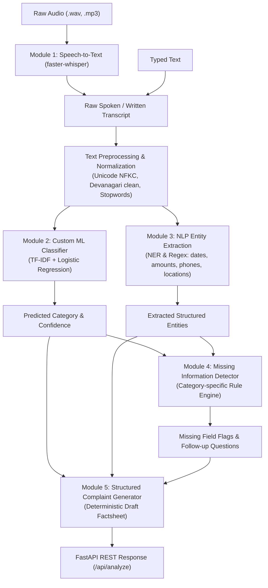

# AwaazSetu — Machine Learning & Deep Learning Engine
### Academic Project: Voice-to-FIR AI-Assisted Police Complaint and Case Management System

> **Prototype & Legal Scope Disclaimer:**  
> AwaazSetu ML Engine is an academic research demonstration designed to assist complainants in drafting structured statements and to assist police officers in triaging, categorizing, and reviewing incident details.  
> **This system does NOT register a legally valid First Information Report (FIR), does NOT make judicial or legal decisions, and does NOT replace an authorized police station house officer (SHO).** In real emergencies, citizens must immediately call **112**.

---

## 1. System Overview & Architecture

The `ml_system/` module is an **independent, CPU-friendly Machine Learning, Deep Learning, and NLP subsystem** for AwaazSetu. It operates entirely locally without any third-party paid AI APIs (no OpenAI, no Gemini, no ChatGPT, no Claude, no external LLM APIs).

### Data & Processing Pipeline



---

## 2. Status: Are Frontend and Backend Integrated?

### **Current Status: Decoupled & Modular (Ready for Connection)**

| Component | Status | Location | Notes |
| :--- | :--- | :--- | :--- |
| **Frontend UI** | **Complete (Phase 1)** | `d:\AwaazSetu\src\` | React 18, TypeScript, Vite, Tailwind CSS. Uses simulated local state and mock data for UI demo. |
| **ML Backend** | **Complete & Verified** | `d:\AwaazSetu\ml_system\` | FastAPI, faster-whisper, Scikit-learn, Joblib. All REST endpoints operational with CORS enabled for `localhost:5173`. |
| **Integration** | **Modular (Not Yet Connected)** | — | The frontend and backend currently run as independent services. The frontend does not yet call `http://localhost:8000/api/...`. |

### Why are they currently decoupled?
As per the project architecture roadmap:
1. **Phase 1** required a self-contained, presentation-ready UI prototype with zero server dependencies so that evaluators could test all screens smoothly.
2. The ML/DL Engine was built inside `ml_system/` as an **independent, fully testable Python engine** with its own virtual environment, automated tests, and evaluation suite.
3. In the subsequent integration phase (Phase 3), the mock services in `src/services/` will be switched to call the FastAPI endpoints (`/api/analyze`, `/api/classify`, `/api/transcribe`).

---

## 3. The 7 Core ML/DL Modules

### Module 1: Deep Learning Speech Recognition (`faster-whisper`)
- **Engine**: OpenAI Whisper architecture via `faster-whisper` (CTranslate2 inference engine).
- **Default Model**: `base` (145 MB, lightweight CPU-compatible, with `small` model support via `config.py`).
- **Capabilities**:
  - Accepts WAV, MP3, and standard audio formats.
  - Automatic language detection (Hindi and English).
  - Word/phrase segment extraction with millisecond timestamps (`start`, `end`).
  - Processing duration tracking.
  - Safe host fallback diagnostic mode on restricted environments.
- **Endpoint**: `POST /api/transcribe` & `POST /api/analyze-audio`

### Module 2: Trained Complaint Classification Model
- **Algorithm**: TF-IDF Vectorizer (word n-grams 1–3 + character n-grams 3–5) paired with **Logistic Regression** (L2 penalty, balanced class weighting), benchmarked against a **Calibrated Linear Support Vector Machine (Linear SVM)**.
- **Categories (7 Classes)**:
  1. `Theft` (e.g., wallet, phone, bag, vehicle stolen)
  2. `Cyber Fraud` (e.g., UPI scam, OTP fraud, phishing, fake lottery)
  3. `Harassment` (e.g., stalking, verbal abuse, workplace/online harassment)
  4. `Missing Person` (e.g., child, parent, relative untraceable)
  5. `Lost Documents` (e.g., Aadhaar, PAN card, passport, driving license misplaced)
  6. `Physical Assault` (e.g., armed attack, fighting, severe battery)
  7. `Other` (e.g., noise pollution, property dispute, public nuisance)
- **Outputs**: Predicted category, calibrated class probability distribution, model confidence score, and model architecture metadata.
- **Endpoint**: `POST /api/classify`

### Module 3: Multilingual Information Extraction (NLP)
- **Approach**: Hybrid NLP pipeline utilizing spaCy language models complemented by a multilingual regex pattern engine for Indian contexts (Devanagari numerals, rupee symbols, Hinglish phrasing).
- **Extracted Entity Types**:
  - `PERSON`: Complainant, suspect, accused, victim names.
  - `LOCATION`: Incident locations, stations, markets, street names.
  - `DATE`: Incident dates (standard formats, relative terms like *yesterday*, *कल*, *20th October*).
  - `TIME`: Incident times (*10:30 PM*, *शाम 7 बजे*, *morning 9 AM*).
  - `MONEY`: Defrauded or stolen amounts (*₹50,000*, *50 हजार रुपये*, *1.2 Lakh*).
  - `PHONE`: 10-digit mobile numbers (+91 prefixes).
  - `OBJECT`: Stolen/lost property (iPhone, laptop, purse, wallet, motorbike).
- **Endpoint**: `POST /api/extract`

### Module 4: Category-Specific Missing Information Detection
- **Approach**: Deterministic rule engine verifying mandatory fields against the predicted category.
- **Examples**:
  - For `Theft`: Checks whether stolen property, date/time, and specific location are provided.
  - For `Cyber Fraud`: Checks whether monetary loss, transaction platform (UPI/ATM), and fraudulent account/phone details are present.
  - For `Missing Person`: Flags missing physical description, age, and last-seen location.
- **Output**: Missing field keys, severity flags, and contextual follow-up questions in English or Hindi.

### Module 5: Structured Complaint Draft Generation
- **Approach**: Deterministic, template-based generation (strictly non-generative to prevent AI hallucination or fabricated legal claims).
- **Output**:
  - Formal Incident Summary.
  - Chronological factsheet (Date, Time, Location).
  - Suspect / Property details table.
  - Prominent non-FIR legal disclaimer banner.

### Module 6: Model Evaluation & Performance Benchmark
- **Stratified Held-Out Test Set Results**:
  - **Overall Accuracy**: `75.0%`
  - **Weighted Precision**: `0.7719`
  - **Weighted Recall**: `0.7500`
  - **Weighted F1 Score**: `0.7422`
- **Confusion Matrix & Metrics Visualizations**: Automatically rendered to `ml_system/evaluation/confusion_matrix.png` and `ml_system/evaluation/classification_metrics.png`.
- **Speech Recognition Benchmark**: Word Error Rate (WER) Levenshtein distance benchmarking against reference transcripts.
- **Endpoint**: `GET /api/evaluation`

### Module 7: Unified FastAPI Backend
- Single-pipeline endpoint (`POST /api/analyze`) combining transcription, classification, entity extraction, missing information detection, and structured complaint generation in a single call.
- Comprehensive Pydantic schema validation.
- Interactive documentation at `/docs` (Swagger UI) and `/redoc`.

---

## 4. Dataset Details

- **Dataset Path**: `ml_system/datasets/raw/complaints_dataset.csv`
- **Total Samples**: 217 hand-curated, realistic complaints.
- **Languages**: Multilingual (English, Hindi in Devanagari script, and colloquial Hinglish).
- **Distribution**:
  - Balanced representation across all 7 categories (~31 samples per category).
  - Processed using stratified 80/20 train/test split into `ml_system/datasets/processed/train.csv` (173 samples) and `test.csv` (44 samples).
- **Academic Limitation Notice**: This dataset is designed for academic demonstration and system validation. It reflects realistic complaints but does not substitute for real-world police FIR registers.

---

## 5. How to Run the ML Backend

### Prerequisites
- Python 3.11 or Python 3.12
- Windows, Linux, or macOS

### Step 1: Activate Virtual Environment
From the project root:
```bash
# Windows PowerShell
& "D:\AwaazSetu\ml_system\.venv\Scripts\Activate.ps1"

# Or Linux / macOS
source ml_system/.venv/bin/activate
```

### Step 2: (Optional) Retrain and Re-Evaluate Models
```bash
# Retrain classification model
python ml_system/training/train_classifier.py

# Run evaluation suite and regenerate confusion matrix
python ml_system/training/evaluate_classifier.py
```

### Step 3: Launch FastAPI Server
```bash
cd ml_system
python -m uvicorn backend.main:app --host 127.0.0.1 --port 8000 --reload
```

The server will start at:
- **API Base URL**: `http://127.0.0.1:8000`
- **Interactive Swagger Documentation**: `http://127.0.0.1:8000/docs`
- **ReDoc Documentation**: `http://127.0.0.1:8000/redoc`

---

## 6. How to Run Automated Tests

The test suite covers classifier inference, NLP entity extraction, missing field detection, structured complaint drafting, and FastAPI integration.

```bash
cd ml_system
python -m pytest tests -v
```

---

## 7. API Reference & Example Requests

### 1. Health & Model Status
- **`GET /health`**
  ```bash
  curl -X GET "http://127.0.0.1:8000/health"
  ```
  Returns status of the classifier and speech recognition engines.

### 2. Classify Complaint Text
- **`POST /api/classify`**
  ```bash
  curl -X POST "http://127.0.0.1:8000/api/classify" \
       -H "Content-Type: application/json" \
       -d '{"text": "Someone broke my car window at Connaught Place and took my laptop."}'
  ```
  *Response:*
  ```json
  {
    "predicted_category": "Theft",
    "confidence": 0.8124,
    "class_probabilities": {
      "Theft": 0.8124,
      "Physical Assault": 0.0521,
      "Cyber Fraud": 0.0315,
      ...
    },
    "model_name": "TFIDF_LogisticRegression"
  }
  ```

### 3. Extract Incident Entities
- **`POST /api/extract`**
  ```bash
  curl -X POST "http://127.0.0.1:8000/api/extract" \
       -H "Content-Type: application/json" \
       -d '{"text": "Yesterday at 9 PM near Rajiv Chowk Metro, my iPhone 14 was stolen by Rahul."}'
  ```

### 4. Full Complaint Analysis Pipeline
- **`POST /api/analyze`**
  ```bash
  curl -X POST "http://127.0.0.1:8000/api/analyze" \
       -H "Content-Type: application/json" \
       -d '{
         "text": "I got a call asking for UPI OTP and lost Rs 45,000 from my SBI account.",
         "language": "en"
       }'
  ```
  Returns category classification, extracted entities, missing information checklist, and a formal draft factsheet.

### 5. Speech-to-Text Transcription
- **`POST /api/transcribe`**
  ```bash
  curl -X POST "http://127.0.0.1:8000/api/transcribe" \
       -F "file=@sample_complaint.wav" \
       -F "language=hi"
  ```

---

## 8. Frontend Integration Roadmap (How to Connect)

To connect the React frontend to this backend in the next phase:

1. **Frontend Service Update**:
   Update `src/services/` to replace local mock functions with `fetch` calls to `http://localhost:8000/api/analyze` and `http://localhost:8000/api/transcribe`.
2. **Audio Recording**:
   Connect browser `navigator.mediaDevices.getUserMedia` in `src/components/AudioRecorder.tsx` to record a real audio Blob and send it as `multipart/form-data` to `POST /api/analyze-audio`.
3. **Live Complaint Review**:
   The response from `/api/analyze` populates the editable transcript, incident particulars form, and missing information alerts directly.
