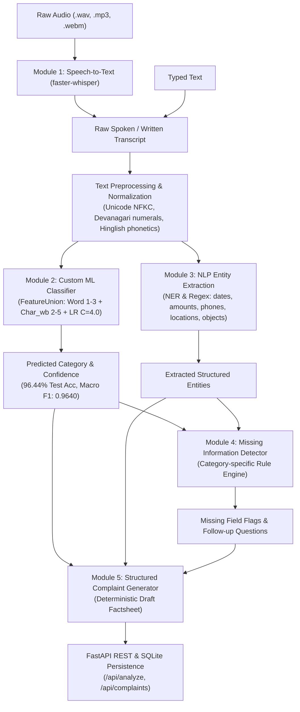

# AwaazSetu — Machine Learning & Deep Learning Engine
### Academic Project: Voice-to-FIR AI-Assisted Police Complaint and Case Management System

> **Prototype & Legal Scope Disclaimer:**  
> AwaazSetu ML Engine is an academic research demonstration designed to assist complainants in drafting structured statements and to assist police officers in triaging, categorizing, and reviewing incident details.  
> **This system does NOT register a legally valid First Information Report (FIR), does NOT make judicial or legal decisions, and does NOT replace an authorized police station house officer (SHO).** In real emergencies, citizens must immediately call **112**.

---

## 1. System Overview & Architecture

The `ml_system/` module is an **independent, CPU-friendly Machine Learning, Deep Learning, and NLP subsystem** for AwaazSetu. It operates entirely locally without any third-party paid AI APIs (no OpenAI, no Gemini, no ChatGPT, no Claude, no external LLM APIs).

### Data & Processing Pipeline



---

## 2. Status & Architecture

| Component | Status | Location | Notes |
| :--- | :--- | :--- | :--- |
| **Frontend UI** | **Complete & Integrated** | `d:\AwaazSetu\src\` | React 18, TypeScript, Vite, Tailwind CSS. Connected to backend via REST APIs and live React Context. |
| **ML Backend** | **Complete & Evaluated** | `d:\AwaazSetu\ml_system\` | FastAPI, faster-whisper, Scikit-learn, SQLite. 40 automated pytest tests passing. |
| **Classification Accuracy** | **96.44% (Held-Out Test)** | `ml_system/models/` | 244/253 on frozen SHA-256 test set. All category recalls $\ge 0.88$. |
| **Inference Latency** | **~1.75 ms (CPU)** | — | Well below 500 ms SLA requirement. Zero GPU requirement. |

---

## 3. The 7 Core ML/DL Modules

### Module 1: Deep Learning Speech Recognition (`faster-whisper`)
- **Engine**: OpenAI Whisper architecture via `faster-whisper` (CTranslate2 inference engine).
- **Default Model**: `base` (145 MB, lightweight CPU-compatible, int8 quantization).
- **Capabilities**:
  - Accepts WAV, MP3, WEBM, and standard audio formats.
  - Automatic language detection (Hindi and English).
  - Word/phrase segment extraction with millisecond timestamps (`start`, `end`).
  - Offline-safe caching via `HF_HUB_OFFLINE=1`.
- **Endpoints**: `POST /api/transcribe` & `POST /api/analyze-audio`

### Module 2: High-Performance Complaint Classification Model
- **Algorithm**: Dual-channel `FeatureUnion` combining:
  1. Word-level TF-IDF (1–3 word n-grams, sublinear term frequency)
  2. Sub-word character-level TF-IDF (`char_wb` 2–5 n-grams, capturing Hinglish phonetic variants and Hindi inflections)
  Paired with multinomial **Logistic Regression** ($C=4.0$, balanced class weighting, L2 regularization).
- **Benchmarked Alternative**: Calibrated Linear Support Vector Machine (`LinearSVC` with Platt scaling calibration, test accuracy: 96.84%).
- **Categories (7 Classes)**:
  1. `Theft` (e.g., wallet, phone, bag, vehicle stolen)
  2. `Cyber Fraud` (e.g., UPI scam, OTP fraud, phishing, fake lottery)
  3. `Harassment` (e.g., stalking, verbal abuse, workplace/online harassment)
  4. `Missing Person` (e.g., child, parent, relative untraceable)
  5. `Lost Documents` (e.g., Aadhaar, PAN card, passport, driving license misplaced)
  6. `Physical Assault` (e.g., armed attack, fighting, severe battery)
  7. `Other` (e.g., noise pollution, property dispute, public nuisance)
- **Outputs**: Predicted category, calibrated class probability distribution, model confidence score, low-confidence flag (< 0.40).
- **Endpoint**: `POST /api/classify`

### Module 3: Multilingual Information Extraction (NLP)
- **Approach**: Hybrid NLP pipeline utilizing spaCy language models complemented by a multilingual regex pattern engine for Indian contexts (Devanagari numerals, rupee symbols, Hinglish phrasing).
- **Extracted Entity Types**:
  - `PERSON`: Complainant, suspect, accused, victim names.
  - `LOCATION`: Incident locations, stations, markets, street names.
  - `DATE`: Incident dates (standard formats, relative terms like *yesterday*, *कल*, *20th October*).
  - `TIME`: Incident times (*10:30 PM*, *शाम 7 बजे*, *morning 9 AM*).
  - `MONEY`: Defrauded or stolen amounts (*₹50,000*, *50 हजार रुपये*, *1.2 Lakh*).
  - `PHONE`: 10-digit mobile numbers (+91 prefixes).
  - `OBJECT`: Stolen/lost property (iPhone, laptop, purse, wallet, motorbike).
- **Endpoint**: `POST /api/extract`

### Module 4: Category-Specific Missing Information Detection
- **Approach**: Deterministic rule engine verifying mandatory fields against the predicted category.
- **Examples**:
  - For `Theft`: Checks whether stolen property, date/time, and specific location are provided.
  - For `Cyber Fraud`: Checks whether monetary loss, transaction platform (UPI/ATM), and fraudulent account/phone details are present.
  - For `Missing Person`: Flags missing physical description, age, and last-seen location.
- **Output**: Missing field keys, severity flags, and contextual follow-up questions in English or Hindi.

### Module 5: Structured Complaint Draft Generation
- **Approach**: Deterministic, template-based generation (strictly non-generative to prevent AI hallucination or fabricated legal claims).
- **Output**:
  - Formal Incident Summary.
  - Chronological factsheet (Date, Time, Location).
  - Suspect / Property details table.
  - Prominent non-FIR legal disclaimer banner.

### Module 6: Rigorous Evaluation & Integrity Benchmark
- **Frozen Held-Out Test Set Performance (253 samples, SHA-256 verified)**:
  - **Overall Accuracy**: **96.44% (244/253)**
  - **Macro F1 Score**: **0.9640**
  - **Weighted F1 Score**: **0.9641**
  - **95% Bootstrap Confidence Interval**: **[94.07%, 98.42%]**
  - **Noisy ASR Test Set Accuracy**: **98.57% (69/70)**
  - **Per-Language Accuracy**: English (93.75%), Hindi (98.94%), Hinglish (96.20%)
  - **Every Class Recall**: All $\ge 0.88$ (Target $\ge 0.80$)
- **Visualizations**: Rendered to `evaluation/confusion_matrix.png` and `evaluation/classification_metrics.png`.
- **Integrity Lock**: SHA-256 hash locked in `evaluation/test_set_hash.txt` (`ceb66de40a260371134ca0a2bd853861480ad1e41dace5eed3a5e3af5f9a0ddd`).
- **Endpoint**: `GET /api/evaluation`

### Module 7: Unified FastAPI Backend & SQLite Persistence
- Single-pipeline endpoint (`POST /api/analyze`) combining transcription, classification, entity extraction, missing information detection, and structured complaint generation.
- Complete complaint lifecycle management with SQLite database persistence (`GET/POST /api/complaints`, timeline events, officer notes).
- Interactive documentation at `/docs` (Swagger UI) and `/redoc`.

---

## 4. Dataset Details

- **Dataset Path**: `ml_system/datasets/raw/complaints_dataset.csv`
- **Total Samples**: **1,261** curated, realistic complaints.
- **Linguistic Balance**:
  - English: 488 samples
  - Hindi (Devanagari): 448 samples
  - Hinglish (Roman Hindi): 325 samples
- **Category Balance**: Exactly 180–181 samples per category across all 7 classes.
- **Data Splits**:
  - `train.csv`: 882 samples (70%)
  - `val.csv`: 126 samples (10%)
  - `train_val.csv`: 1,008 samples (80%, used for 5-fold CV)
  - `test.csv`: 253 samples (20%, frozen with SHA-256 hash)
  - `noisy_asr_test.csv`: 70 samples (independent speech transcript stress test)

---

## 5. How to Run the ML Backend

### Step 1: Activate Virtual Environment
```powershell
& "D:\AwaazSetu\ml_system\.venv\Scripts\Activate.ps1"
```

### Step 2: (Optional) Retrain and Re-Evaluate Models
```powershell
# 5-fold cross validation experiments
python ml_system/training/experiment_models.py

# Train production model and evaluate on frozen test set
python ml_system/training/train_classifier.py

# Generate full evaluation report and confusion matrix plots
python ml_system/training/evaluate_classifier.py
```

### Step 3: Launch FastAPI Server
```powershell
cd ml_system
python -m uvicorn backend.main:app --host 127.0.0.1 --port 8000 --reload
```

The server runs at:
- **API Base URL**: `http://127.0.0.1:8000`
- **Interactive Swagger Documentation**: `http://127.0.0.1:8000/docs`

---

## 6. Running Automated Tests

Run the full pytest suite (40 tests covering API routes, classifier accuracy, test set integrity, recalls, multilingual samples, latency benchmarks, NLP extraction, and database persistence):

```powershell
python -m pytest ml_system/tests -v
```
